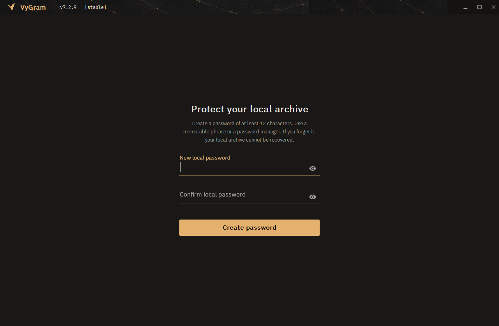

# VyGram

A personal Telegram desktop client for Windows. It is a fork of
[AyuGram Desktop](https://github.com/AyuGram/AyuGramDesktop), which is based on
[Telegram Desktop](https://github.com/telegramdesktop/tdesktop).

[ [Русский](README.md) | English ]



> **Status: alpha.** Features are built and covered by component tests; end-to-end checks
> in a signed-in client are not finished yet. Do not use this build as the only copy of an
> important profile.

## What it adds on top of AyuGram

Everything AyuGram offers (ghost mode, deleted and edited message history, anti-recall,
translator and more) is kept. VyGram adds:

### Privacy and storage

- **Protected local archive.** Deleted and edited messages, media and settings live in a
  SQLCipher database encrypted with the profile master key.
- **Mandatory local password.** The master key is wrapped with scrypt (N=65536, r=8, p=1);
  at least 12 characters, simple patterns are rejected. A forgotten password cannot be
  recovered.
- **Saving selected chats.** Enabled manually per chat. Loaded messages and available
  attachments stay in the archive even if the other side deletes the chat for everyone.
- **Archive center.** Saved chats, including ones gone from the Telegram chat list, with
  text search, date and type filters, attachment export and per-chat cleanup.
- **Protection status screen.** Real archive state, window lock and full profile shutdown.
- **Per-chat privacy.** Typing, recording and upload indicators can be overridden for a
  single chat and reset to global settings.
- Regular file logs and built-in crash dumps are disabled.

### Messaging

- **Send templates.** A per-account library of round videos, voice messages, videos and
  photos with preview, a delay with a recording indicator and sending through the regular
  media pipeline.
- **Local labels.** Device-only chat labels with a quick filter. Server folders are untouched.

### Graphite interface

- Warm graphite palette with an amber accent, grain, IBM Plex Sans and JetBrains Mono.
- Title bar with version, build channel and connection state.
- Side navigation (wide 168 px or compact 64 px) for all chats, contacts, groups,
  channels, archive, saved messages, activity, downloads and folders.
- Chat list with "Pinned" and "All chats" sections.
- Forum-style message feed: grouping by author, date separators, message numbers when
  there is enough width.
- "Graphite" and "Cold steel" themes; background, grain, text and avatar size settings;
  JSON import and export.
- VyGram screens are fully translated to Russian; the language follows the client language.

### Command palette and shortcuts

| Shortcut | Action |
| --- | --- |
| `Ctrl+K` | Command palette: search chats and client actions (with selected text — link) |
| `Ctrl+,` | Settings |
| `Ctrl+N` | Contacts |
| `Ctrl+G` | Saved messages |
| `Ctrl+J` | Downloads |
| `Ctrl+Shift+M` | Toggle notifications for the current chat |
| `Alt+1…9` | Open a chat folder by number |

Shortcuts also work with a Cyrillic keyboard layout.

## Protection limits

Protection covers data at rest of a closed profile. Locking the window hides the UI but
does not unload keys or the session from memory; close the client to remove the live
session from the process. The client does not protect against an administrator, malware,
screen capture or an already unlocked process. VyGram does not add end-to-end encryption
to cloud chats. No independent security audit has been performed.

See [docs/protected-storage.md](docs/protected-storage.md) for details.

## Building

Windows x64, Debug configuration only. Prepare the environment following
[docs/building-win.md](docs/building-win.md) and clone with submodules:

```powershell
git clone --recursive https://github.com/ChillArtisan/VyGram.git
```

Build from the x64 Native Tools Command Prompt (`vcvars64.bat -vcvars_ver=14.44`) in the
repository root:

```powershell
cmake --build out --config Debug --target Telegram --parallel 4
```

The output is `out\Debug\VyGram.exe`.

For fast rebuilds there is an opt-in incremental MSVC link for Debug. With it, a rebuild
after editing one `.cpp` takes about 40 seconds instead of several minutes:

```powershell
cmake -S . -B out -DVYGRAM_LOCAL_INCREMENTAL_LINK=ON
```

Use your own `api_id` and `api_hash` from [my.telegram.org](https://my.telegram.org),
passed at configure time via `-DTDESKTOP_API_ID` and `-DTDESKTOP_API_HASH`.

### Tests

```powershell
py -3 -m unittest discover -s tools/tests -p "test_terminal_*.py" -v
```

C++ tests for storage, password policy, privacy and MP4 parsing live in `tools/tests/` and
are built separately from the client.

## Documentation

- [Terminal and Graphite design](docs/terminal-design.md)
- [Protected storage](docs/protected-storage.md)
- [Send templates](docs/send-templates.md)

## Roadmap

- End-to-end checks on Telegram test servers.
- CI builds.
- Full-text search across the whole archive, saved chat export to HTML/JSON, edit history
  as a diff, encrypted archive backup.
- More command palette actions, local contact notes, full-window settings.

## Credits and license

VyGram is based on [AyuGram Desktop](https://github.com/AyuGram/AyuGramDesktop) and
[Telegram Desktop](https://github.com/telegramdesktop/tdesktop); upstream history and
attribution are retained. Licensed under [GPL v3](LICENSE) with the OpenSSL exception, as
the upstream project.

IBM Plex Sans and JetBrains Mono are distributed under the SIL Open Font License, included
in `Telegram/Resources/fonts`.

VyGram is an unofficial client and is not affiliated with Telegram or the AyuGram team.
