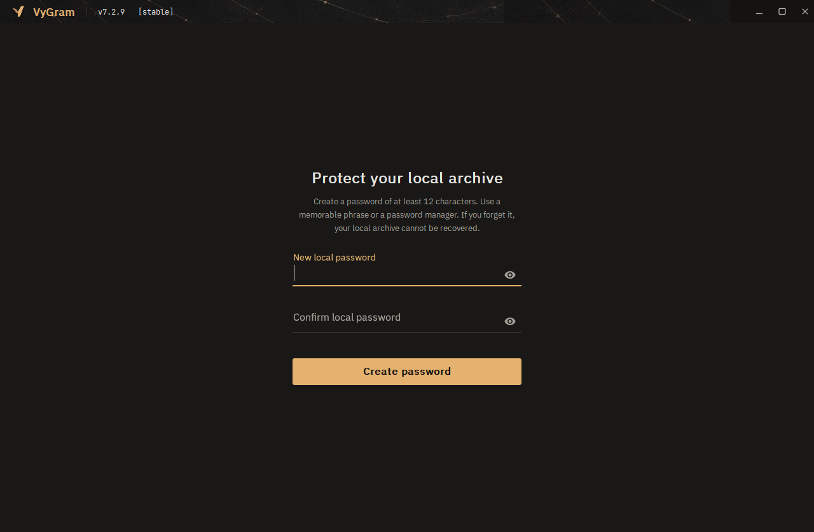

# VyGram

Личный десктопный клиент Telegram для Windows. Форк [AyuGram Desktop](https://github.com/AyuGram/AyuGramDesktop),
который, в свою очередь, основан на [Telegram Desktop](https://github.com/telegramdesktop/tdesktop).

[ Русский | [English](README-EN.md) ]



> **Статус: альфа.** Функции собраны и проверены отдельными тестами, сквозные проверки
> в авторизованном клиенте ещё не завершены. Не используйте эту сборку как единственную
> копию важного профиля.

## Чем отличается от AyuGram

Всё, что умеет AyuGram (режим призрака, история удалённых и изменённых сообщений,
антиотзыв, переводчик и прочее), сохранено. Сверху добавлено:

### Приватность и хранение

- **Защищённый локальный архив.** Удалённые и изменённые сообщения, медиа и настройки
  хранятся в базе SQLCipher, зашифрованной мастер-ключом профиля.
- **Обязательный локальный пароль.** Мастер-ключ обёрнут scrypt (N=65536, r=8, p=1);
  минимум 12 символов, простые шаблоны отклоняются. Восстановить забытый пароль нельзя.
- **Сохранение выбранных чатов.** Включается вручную для отдельного диалога. Загруженные
  сообщения и доступные вложения остаются в архиве, даже если собеседник удалил чат
  для обеих сторон.
- **Центр архива.** Сохранённые диалоги, в том числе пропавшие из списка Telegram:
  поиск по тексту, фильтры по дате и типу, сохранение вложений, очистка копии.
- **Экран состояния защиты.** Фактическое состояние архива, блокировка окна и полное
  закрытие профиля.
- **Приватность для отдельного чата.** Индикаторы набора, записи и загрузки можно
  переопределить для конкретного диалога со сбросом к глобальным настройкам.
- Обычные файловые логи и встроенные краш-дампы отключены.

### Работа с сообщениями

- **Заготовки отправки.** Библиотека кружков, голосовых, видео и фото для каждого аккаунта
  отдельно: предпросмотр, задержка с индикатором записи, отправка через штатный конвейер.
- **Локальные метки.** Пометки диалогов, которые хранятся только на устройстве,
  и быстрый фильтр по ним. Серверные папки не меняются.

### Интерфейс Graphite

- Тёплая графитовая палитра с янтарным акцентом, зерно, IBM Plex Sans и JetBrains Mono.
- Шапка окна с версией, каналом сборки и состоянием подключения.
- Боковая навигация (широкая 168 px или компактная 64 px) со всеми чатами, контактами,
  группами, каналами, архивом, избранным, активностью, загрузками и папками.
- Список чатов с секциями «Закреплённые» и «Все чаты».
- Лента сообщений в стиле форума: группировка по автору, разделители дат,
  номера сообщений при достаточной ширине.
- Темы «Графит» и «Холодная сталь», настройка фона, зерна, размера текста и аватаров,
  импорт и экспорт параметров в JSON.
- Интерфейс VyGram полностью переведён на русский; язык выбирается по языку клиента.

### Палитра команд и горячие клавиши

| Сочетание | Действие |
| --- | --- |
| `Ctrl+K` | Палитра команд: поиск чатов и действий клиента (при выделенном тексте — ссылка) |
| `Ctrl+,` | Настройки |
| `Ctrl+N` | Контакты |
| `Ctrl+G` | Избранное |
| `Ctrl+J` | Загрузки |
| `Ctrl+Shift+M` | Включить или выключить уведомления текущего чата |
| `Alt+1…9` | Переход к папке чатов по номеру |

Сочетания работают и на русской раскладке.

## Ограничения защиты

Защита касается данных на диске закрытого профиля. Блокировка окна скрывает интерфейс,
но не выгружает ключи и сессию из памяти. Чтобы убрать живую сессию из процесса,
клиент нужно закрыть. От администратора, вредоносного ПО, захвата экрана и уже
разблокированного процесса клиент не защищает. Сквозного шифрования облачных чатов
VyGram не добавляет. Независимый аудит безопасности не проводился.

Подробности — в [docs/protected-storage.md](docs/protected-storage.md).

## Сборка

Поддерживается Windows x64, только конфигурация Debug. Окружение готовится по
[docs/building-win.md](docs/building-win.md). Репозиторий клонируется с подмодулями:

```powershell
git clone --recursive https://github.com/ChillArtisan/VyGram.git
```

Сборка из x64 Native Tools Command Prompt (`vcvars64.bat -vcvars_ver=14.44`) в корне репозитория:

```powershell
cmake --build out --config Debug --target Telegram --parallel 4
```

Результат — `out\Debug\VyGram.exe`.

Для быстрых повторных сборок есть опция инкрементальной линковки MSVC, только для Debug.
С ней пересборка после правки одного `.cpp` занимает около 40 секунд вместо нескольких минут:

```powershell
cmake -S . -B out -DVYGRAM_LOCAL_INCREMENTAL_LINK=ON
```

Нужны собственные `api_id` и `api_hash` с [my.telegram.org](https://my.telegram.org),
их передают при конфигурации через `-DTDESKTOP_API_ID` и `-DTDESKTOP_API_HASH`.

### Тесты

```powershell
py -3 -m unittest discover -s tools/tests -p "test_terminal_*.py" -v
```

C++-тесты хранилища, политики паролей, приватности и разбора MP4 лежат в `tools/tests/`
и собираются отдельно от клиента.

## Документация

- [Оформление Terminal и Graphite](docs/terminal-design.md)
- [Защищённое хранение](docs/protected-storage.md)
- [Заготовки отправки](docs/send-templates.md)

## Планы

- Сквозные проверки на тестовых серверах Telegram.
- Сборка в CI.
- Полнотекстовый поиск по всему архиву, экспорт сохранённого чата в HTML/JSON,
  история правок в виде диффа, зашифрованный бэкап архива.
- Расширение палитры команд, локальные заметки к контактам, настройки во всё окно.

## Благодарности и лицензия

VyGram основан на [AyuGram Desktop](https://github.com/AyuGram/AyuGramDesktop) и
[Telegram Desktop](https://github.com/telegramdesktop/tdesktop). История и атрибуция
исходных проектов сохранены. Распространяется под [GPL v3](LICENSE) с исключением
для OpenSSL, как и исходный проект.

Шрифты IBM Plex Sans и JetBrains Mono распространяются по лицензии SIL Open Font License.
Её текст лежит в `Telegram/Resources/fonts`.

VyGram — неофициальный клиент, не связанный с Telegram и командой AyuGram.
